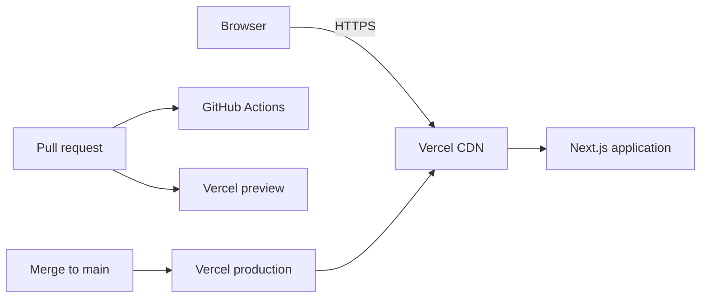

# Project implementation plan

This plan takes `pstack-playground` from a repository with no application code to a tested, deployed web application foundation. The product is not defined yet, so the plan commits only to work that a generic web application needs. Product features wait for the product definition in PR 11.

Package versions and vendor facts were checked on 2026-10-31.

## Project overview and objectives

`pstack-playground` is a generic TypeScript web application hosted on Vercel. The owner has not yet named its purpose, its users, or its features.

The objectives are:

1. Reach a production deployment that passes automated checks on every change.
2. Keep each step small enough to review on its own.
3. Delay product-specific choices, such as a database or sign-in, until a requirement needs them.

## Requirements

The owner has not set these requirements. They are proposed defaults for the foundation, and PR 11 confirms or replaces them.

### Functional requirements

The foundation delivers these behaviors:

- FR1. A visitor can open the home page at the production URL.
- FR2. A visitor who opens an unknown URL sees a not-found page with a link to the home page.
- FR3. A visitor sees an error message with a retry action when page content fails to render.
- FR4. A keyboard user can reach every link and button on the home page and the not-found page.

Product features are undefined. PR 11 records them in `docs/PRODUCT.md`.

### Non-functional requirements

| Area | Proposed target |
| --- | --- |
| Accessibility | `axe` finds no WCAG 2.2 AA violations on the home page or the not-found page |
| Performance | Lighthouse performance score of 90 or more on the production home page |
| Reliability | `main` stays deployable, and a failed deployment leaves the last good deployment live |
| Change safety | Every change to `main` passes lint, type checks, unit tests, browser tests, and a production build |
| Browser support | The Chromium version that Playwright installs |

## Technology stack and rationale

The existing tooling points to this direction. `scripts/install_pkgs.sh` installs JavaScript dependencies, and `.claude/settings.json` blocks Vercel production deploys from agents.

| Concern | Choice | Rationale |
| --- | --- | --- |
| Runtime | Node.js `26.x` | Node.js lists 26 as the latest LTS release, and Vercel uses it by default. |
| Framework | Next.js `16.4.x` with React `19.x` | One framework covers pages and server code, and Vercel detects it with no extra configuration. |
| Language | TypeScript `6.0.x`, strict mode | `eslint-config-next` requires `typescript-eslint` 8, which requires TypeScript below 6.1. That range excludes TypeScript 7. |
| Package manager | npm | npm ships with Node.js, and `install_pkgs.sh` already runs `npm ci`. pnpm and Yarn add a tool to install. |
| Linting | ESLint `9.39.x` with `eslint-config-next` | The React, import, and `jsx-a11y` plugins that `eslint-config-next` installs accept ESLint 9 but not ESLint 10. |
| Unit tests | Vitest `5.x` with Testing Library | The Next.js docs include a Vitest setup, and Vitest 5 supports Node.js 26. |
| Browser tests | Playwright `1.64.x` with `@axe-core/playwright` | Playwright tests a production build in a real browser. `install_pkgs.sh` installs Chromium for it in Claude Code cloud sessions only. |
| CI | GitHub Actions | The repository is on GitHub, and public repositories run standard hosted runners at no cost. |
| Hosting | Vercel with Git integration | Each pull request gets a preview, and each merge to `main` deploys to production without an agent running a deploy command. |

Styling uses CSS Modules, which Next.js supports with no added dependency. A database, an ORM, a sign-in library, and a component library are not part of the foundation.

## System architecture

The foundation is one Next.js application with no external services.



Three rules shape the code:

1. Pages are React Server Components by default. A component becomes a client component only when it needs browser state or events.
2. Code at a boundary validates its input. Boundaries are form submissions, route handlers, and environment variables. Internal code trusts its types.
3. A folder or layer needs a current requirement. Empty service, repository, or provider layers do not ship.

## Repository structure

This tree shows the repository after PR 10. `src/lib/` and `src/components/` are not in the tree, because no foundation code needs them. Add each one when the first file needs it.

```text
.
|-- .claude/settings.json          Agent permissions and session hook
|-- .github/
|   |-- dependabot.yml             Dependency update schedule
|   `-- workflows/ci.yml           Pull request checks
|-- docs/
|   |-- DEPLOYMENT.md              Vercel setup, rollback, and secrets
|   `-- PLAN.md                    This plan
|-- e2e/                           Playwright tests
|-- public/                        Static files
|-- scripts/install_pkgs.sh        Cloud session dependency install
|-- src/app/                       Routes, layouts, and error pages
|-- .gitignore
|-- .nvmrc                         Local Node.js version
|-- LICENSE                        Added in PR 8
|-- README.md                      Created with the repository
|-- eslint.config.mjs
|-- next.config.ts
|-- package.json
|-- package-lock.json
|-- playwright.config.ts
|-- tsconfig.json
`-- vitest.config.mts
```

Unit tests sit next to the code they test, as `*.test.tsx`.

## Data model and API design

The foundation stores no data and exposes no public API. No requirement needs either one, so this plan defines no tables, endpoints, or API conventions. PR 11 makes those decisions if the product needs them.

## Security strategy

The repository will be public, so everything in it, including this plan, is visible to anyone.

- Vercel environment variables hold all secrets. `.gitignore` excludes `.env*` files and keeps `.env.example` through a `!.env.example` line.
- GitHub secret scanning and push protection are on, and Dependabot opens dependency updates. PR 7 confirms both.
- `next.config.ts` sets `X-Content-Type-Options`, `Referrer-Policy`, `Permissions-Policy`, and a `frame-ancestors` content security policy.
- A full nonce-based content security policy waits for a need, because nonces force dynamic rendering of every page.
- GitHub Actions workflows set `permissions: contents: read`, pin actions to commit SHAs, and use the `pull_request` trigger. They never use `pull_request_target`.
- `.claude/settings.json` denies direct pushes to `main`, force pushes, and Vercel production commands. Those rules name only the `Bash` tool, so PR 2 adds matching `PowerShell` rules.

## Testing strategy

Tests assert what a visitor can observe.

| Layer | Tool | Scope | Runs in |
| --- | --- | --- | --- |
| Static | ESLint, `next typegen`, `tsc --noEmit` | All source files | CI |
| Unit | Vitest | Synchronous and client components | CI |
| Browser | Playwright, `axe` | Page behavior against a production build | CI |
| Smoke | Playwright with `BASE_URL` set | The production URL | Manual, after PR 8 and when a deployment looks wrong |
| Performance | PageSpeed Insights | The production home page | Manual, after PR 10 merges |

Vitest does not support `async` Server Components, so Playwright covers those. FR3 is a Vitest test of `error.tsx`, because a browser test would need a failing route in production. CI enforces no coverage percentage, because a number would reward tests that assert nothing.

## Deployment strategy

Vercel builds from Git, and no human or agent deploys from a command line.

1. A pull request gets a Vercel preview deployment and a CI run.
2. The owner merges the pull request after CI passes.
3. Vercel deploys `main` to production.

To roll back a bad deployment, the owner follows these steps in the Vercel dashboard:

1. Run Instant Rollback. The Vercel Hobby plan can return only to the immediately previous deployment.
2. Revert the bad commit on `main` through a pull request. This deployment does not go live yet, because a rollback turns off automatic production updates.
3. When the revert deployment is ready, select **Undo Rollback** and choose that deployment. This step turns automatic production updates back on.

`docs/DEPLOYMENT.md` holds these steps once PR 8 merges. The owner performs every merge and every rollback.

## Development phases and pull requests

Each pull request merges into `main` after the pull requests it depends on. Each one must leave `main` in a passing state.

| PR | Milestone | Title | Depends on |
| --- | --- | --- | --- |
| 1 | M0 | Add this plan | None |
| 2 | M1 | Track the agent tooling | PR 1 |
| 3 | M1 | Scaffold the Next.js application | PR 2 |
| 4 | M1 | Add unit tests | PR 3 |
| 5 | M1 | Add browser tests | PR 3 |
| 6 | M1 | Add CI | PR 4, PR 5 |
| 7 | M1 | Protect `main` and add Dependabot | PR 6 |
| 8 | M2 | Connect Vercel | PR 7 |
| 9 | M2 | Add security headers | PR 7 |
| 10 | M3 | Add the application shell | PR 8, PR 9 |
| 11 | M4 | Define the product | PR 10 |
| 12+ | M5 | Build the product | PR 11 |

### M0. Agree on the plan

The public repository `Marichka20/pstack-playground` does not exist yet, and PR 1 needs a `main` branch to target. Create the repository on GitHub with a generated `README.md`, which gives `main` its first commit. This approach avoids a direct push to `main`, which `.claude/settings.json` denies.

**PR 1. Add this plan.** This pull request adds `docs/PLAN.md` and no other file.

**Acceptance criteria.** The owner has reviewed the plan and merged PR 1.

### M1. Build the verified foundation

**PR 2. Track the agent tooling.** Commit `.claude/settings.json` and `scripts/install_pkgs.sh`, which exist locally but stay out of PR 1. Add the `PowerShell` deny rules from the security strategy.

**PR 3. Scaffold the Next.js application.** Upgrade local Node.js to `26.x` first. The local 20.9.0 can run Next.js, but Vitest 5, `jsdom`, and `@axe-core/playwright` reject it, and this PR must test the target runtime. Run this command in a temporary folder, then copy the output into the repository:

```bash
npx create-next-app@16.4.3 app --ts --eslint --app --src-dir --use-npm --no-tailwind --no-agents-md --no-agent-feedback --disable-git --yes
```

Keep the Cache Components default. Pin TypeScript to `~6.0.3`, ESLint to `~9.39.5`, and `@types/node` to `26.x`. The scaffold sets `@types/node` to `^20`, which is outside the Vitest 5 peer range. Set `engines.node` to `26.x`, add `.nvmrc`, and add `!.env.example` to the scaffold's `.gitignore`. Add the scripts `"lint": "eslint ."` and `"typecheck": "next typegen && tsc --noEmit"`. This PR is the first real test of the stack, so finish it before other work builds on these versions.

**PR 4. Add unit tests.** Install `vitest`, `@vitejs/plugin-react`, `jsdom`, `@testing-library/react`, `@testing-library/dom`, and `vite-tsconfig-paths`. Add `vitest.config.mts` and the script `"test": "vitest run"`. Add one test that renders the home page and asserts its main heading.

**PR 5. Add browser tests.** Install `@playwright/test` and `@axe-core/playwright`. Add `playwright.config.ts`, the script `"test:e2e": "playwright test"`, and a test that opens the home page against a production build and runs `axe`. The test must read the target URL from `BASE_URL` when it is set.

**PR 6. Add CI.** Add `.github/workflows/ci.yml` with the settings from the security strategy. It runs on each pull request and runs these steps in order:

1. `npm ci`
2. `npm run lint`
3. `npm run typecheck`
4. `npm test`
5. `npm run build`
6. `npx playwright install --with-deps chromium`
7. `npm run test:e2e`

**PR 7. Protect `main` and add Dependabot.** Add a weekly `.github/dependabot.yml` for the `npm` and `github-actions` ecosystems. Ignore minor and major updates of `typescript`, because TypeScript 6.1 is outside the `typescript-eslint` range. Ignore major updates of `eslint` and `@types/node`. Add a ruleset on `main` that requires a pull request and a passing CI job, or use a classic branch protection rule if GitHub does not offer rulesets on this account. Require no approving review, because a sole owner cannot approve their own pull request. Confirm that secret scanning and push protection are on.

**Acceptance criteria.**

- On a clean clone with Node.js 26, `npm ci` exits with code 0. So do `npm run lint`, `npm run typecheck`, `npm test`, `npm run build`, `npx playwright install chromium`, and `npm run test:e2e`, run in that order.
- `ci.yml` sets `permissions: contents: read`, pins each action to a commit SHA, and has no `pull_request_target` trigger.
- A pull request with a deliberate lint error shows a failing CI job, and GitHub blocks its merge.
- GitHub rejects `git push origin main` from a local clone.
- Repository settings show secret scanning and push protection as on.

### M2. Deploy safely

**PR 8. Connect Vercel.** Before this PR, the owner answers open questions 8 and 9. The owner imports the repository into Vercel, because that step needs the owner's account. Add `docs/DEPLOYMENT.md` with the setup, rollback, and secret steps. Add `LICENSE` with the chosen license.

**PR 9. Add security headers.** Add the headers from the security strategy to `next.config.ts`. Add a Playwright test that reads them from a response.

**Acceptance criteria.**

- A pull request shows a Vercel preview URL.
- A merge to `main` updates the production URL with no command line deploy.
- The owner followed the rollback steps in `docs/DEPLOYMENT.md` once, and the next merge to `main` reached production automatically.
- The Playwright test reads each security header from a response.

### M3. Build the application shell

**PR 10. Add the application shell.** Add a shared layout, a page title and description, `not-found.tsx`, and `error.tsx`. Add Vitest tests for `error.tsx`, which assert that it shows a message and that its retry button calls the retry function. Add Playwright tests for FR1, FR2, and FR4, with `axe` checks on the home page and the not-found page.

FR3 covers page content under the root layout. A failure in the root layout itself would need `global-error.tsx`, which this plan leaves out because the layout has no data or logic.

**Acceptance criteria.**

- The Playwright tests for FR1, FR2, and FR4 and the Vitest tests for FR3 pass in CI.
- `axe` reports no violations on the home page or the not-found page.
- After merge, PageSpeed Insights scores the production home page at 90 or more for performance.

### M4. Define the product

**PR 11. Define the product.** The owner writes or approves `docs/PRODUCT.md`, which answers the product questions in this plan. Update this plan's requirements and PR 12+ to match. If the product stores data or exposes an API, PR 11 also defines the data model and API conventions. This pull request adds no application code.

**Acceptance criteria.**

- Every product question in this plan has an answer or a named owner.
- PR 12+ is a dependency-ordered list of pull requests, each with acceptance criteria.

### M5. Build the product

PR 12+ is not defined. If the product needs them, the likely order is the data layer, sign-in, and then the first feature. PR 11 chooses the data store and the sign-in provider and states why.

**Acceptance criteria.** PR 11 sets these criteria.

## Risks

| Risk | Effect | Response |
| --- | --- | --- |
| The stack has not run together. The compatibility data comes from npm metadata and vendor docs, because the trial build was not allowed to run. | PR 3 or PR 4 fails or needs other versions. | PR 3 runs before other work depends on these versions. Change the pins there and update this plan. |
| TypeScript and ESLint are pinned below their latest versions. | Language and security updates arrive later. | Remove each pin when `typescript-eslint` and the Next.js ESLint plugins support the newer version. |
| A rollback turns off automatic production updates. | Merges stop reaching production with no error. | Follow the rollback steps to the end. M2 tests them once. |
| A secret is committed to the public repository. | The secret is exposed permanently. | Use push protection, and rotate any exposed secret at once. |
| Vercel applies Node.js minor updates on its own schedule. | Production and CI can run different minor versions. | Accept this. CI and Vercel stay on the same major version. |
| The foundation may not fit the product. | Some of the work needs to change. | The foundation has no database, sign-in, or external service to replace. |

## Assumptions

- The product is a web application that a browser reaches over HTTPS.
- One owner reviews and merges every pull request.
- Vercel's default region and build settings are acceptable.
- The repository will be `Marichka20/pstack-playground`, and it will be public.

## Open questions

The owner decides each of these. Questions 1 through 7 do not block the foundation.

Product questions, for PR 11:

1. What does the application do, and what problem does it solve?
2. Who uses it, and do they need accounts?
3. Which features must the first version include?
4. What data does it store, and is any of it personal or regulated?
5. Does it use outside services, such as payments, email, or AI?
6. What usage, deadlines, and budget apply?
7. Do the proposed functional and non-functional requirements fit?

Project questions:

8. Before PR 8, does the project need a paid Vercel plan? Vercel's Hobby plan is for non-commercial use.
9. Before PR 8, which license applies? A public repository with no license grants no one the right to reuse the code.
10. Before PR 8 merges, does the project need a custom domain, or is the Vercel URL enough?
11. In PR 11, will the repository keep the name `pstack-playground`?
